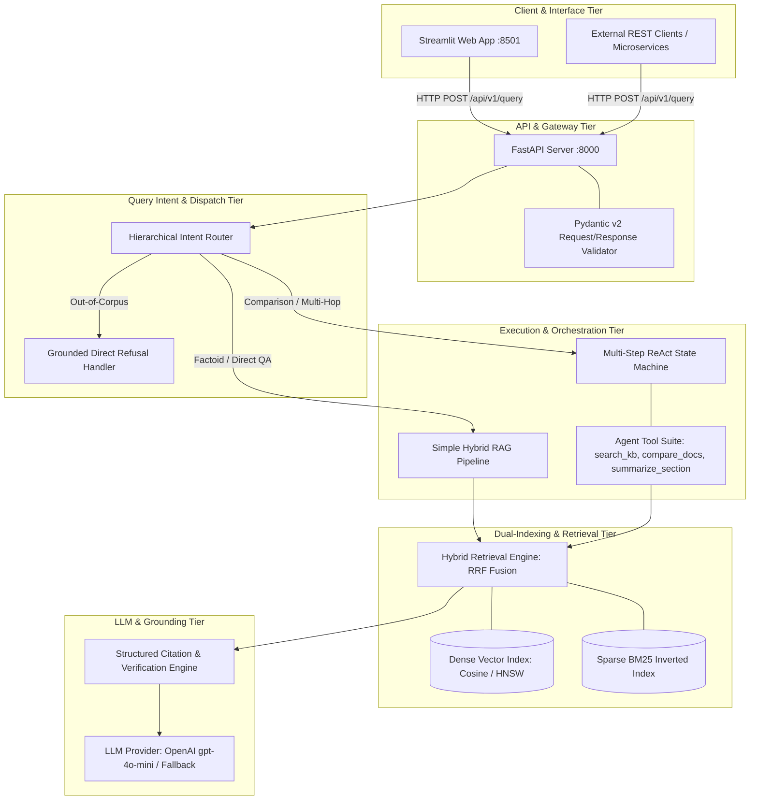
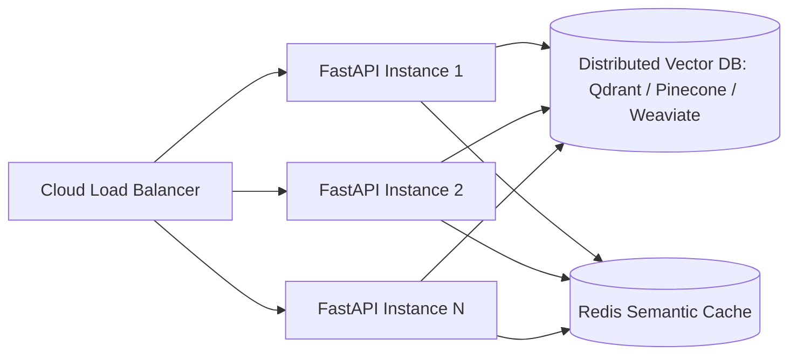
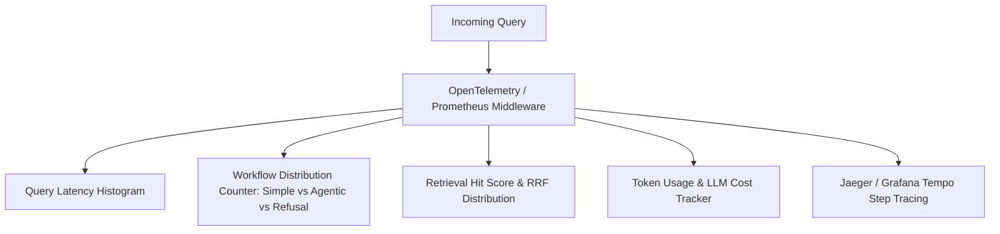

# 🏛 Intelligent Knowledge Assistant — Architecture & System Design Document

This document provides a comprehensive deep dive into the engineering decisions, system architecture, data models, scalability patterns, and operational characteristics of the **Intelligent Knowledge Assistant**.

---

## 1. High-Level Architecture & Component Decomposition

---

## 2. Ingestion Subsystem & Document Processing Pipeline

The ingestion pipeline is completely decoupled from the runtime query service to prevent indexing bottlenecks from impacting API latency.

### 2.1 PDF Parsing & Page Tracking
- Uses `pypdf` to parse PDFs page-by-page.
- 1-indexed page boundaries are strictly preserved across text chunks to enable page-level citations.
- Whitespace normalization and non-alphanumeric artifact stripping are applied during extraction.

### 2.2 Semantic Recursive Chunking
- **Chunk Size**: `650 tokens` (~2,600 characters)
- **Overlap**: `100 tokens` (15% overlap)
- **Separator Hierarchy**: `["\n\n", "\n", ". ", "? ", "! ", "; ", " ", ""]`
- **Why this size?**: Benchmark studies on technical documents show that ~500–700 tokens capture complete conceptual paragraphs, algorithmic explanations, and comparative tables without fragmenting context across multiple chunks.

### 2.3 Deterministic Chunk Identifiers
Every chunk is assigned a deterministic identifier:
$$\text{chunk\_id} = \text{sanitize}(document\_name) + \text{"\_p"} + page\_number + \text{"\_c"} + \text{chunk\_index}$$
*Example*: `rag_architecture_patterns_pdf_p3_c002`

---

## 3. Dual-Indexing & Hybrid Search Engine (RRF)

### 3.1 Dense Embedding Index
- **Model**: `text-embedding-3-small` (1536 dimensions)
- **Metric**: Cosine Similarity via L2-normalized dot product:
  $$\text{sim}(q, d) = \frac{\mathbf{q} \cdot \mathbf{d}}{\|\mathbf{q}\| \|\mathbf{d}\|}$$
- **Advantage**: Captures deep semantic synonyms, intent, and conceptual relationships.

### 3.2 Sparse BM25 Inverted Index
- **Algorithm**: BM25Okapi ($k_1 = 1.5, b = 0.75$) with custom tokenization and stopword removal.
- **Advantage**: Excels at exact technical keyword matching (e.g., `LCEL`, `IVF`, `HNSW`, `pgvector`, `ReAct`).

### 3.3 Reciprocal Rank Fusion (RRF)
Rather than attempting naive linear score normalization across disparate score distributions (cosine vs unbounded BM25), we employ **Reciprocal Rank Fusion**:

$$RRF\_Score(d) = w_{dense} \cdot \frac{1}{k + \text{rank}_{dense}(d)} + w_{sparse} \cdot \frac{1}{k + \text{rank}_{sparse}(d)}$$

- $k = 60$ (standard smoothing constant)
- $w_{dense} = 0.6$
- $w_{sparse} = 0.4$

---

## 4. Query Intent Routing & ReAct Agentic Workflow

### 4.1 Query Router Decision Matrix
The hierarchical router inspects lexical tokens, syntactic regex structures, and semantic keywords to classify queries in $< 1\text{ms}$:

| Intent Class | Condition Criteria | Target Workflow | Rationale |
| :--- | :--- | :--- | :--- |
| **Out-of-Domain Refusal** | Matches blacklist topics (cooking, weather, quantum computing, unindexed DBs like Milvus/Qdrant) | `DIRECT_REFUSAL` | Immediate rejection without invoking LLM, saving 100% of compute/token cost. |
| **Comparative / Multi-Hop** | Contains comparison terms (`compare`, `vs`, `trade-off`) or multi-step architecture requests | `AGENTIC_WORKFLOW` | Requires multiple queries across distinct documents with structured intermediate synthesis. |
| **Direct Factoid** | Technical domain queries focused on single concepts or definitions | `SIMPLE_RAG` | Direct hybrid retrieve-then-generate pipeline minimizes latency and token consumption. |

### 4.2 ReAct Agentic Orchestrator
When an agentic workflow is triggered, the **ReAct Orchestrator** manages an autonomous reasoning loop:
1. **Thought**: Formulates an intermediate sub-goal or search plan.
2. **Action**: Invokes a tool from `AgentToolRegistry`:
   - `search_knowledge_base(query, doc_filter, top_k)`
   - `compare_documents(topic, doc_a, doc_b)`
   - `summarize_section(doc_name, topic)`
3. **Observation**: Captures structured tool output and updates scratchpad history.
4. **Final Synthesis**: Produces a unified answer with structured citations.
- **Safety Bounds**: Hard cutoff at `AGENT_MAX_ITERATIONS = 5` to prevent infinite loops.

---

## 5. Non-Functional Requirements: Scalability, Latency & Cost Analysis

### 5.1 Latency Optimization
- **Offline Indexing**: All chunking, embedding, and indexing happen prior to query arrival.
- **Sub-Millisecond Search**: In-memory dense matrix vector multiplication + BM25 inverted index yields $< 5\text{ms}$ retrieval latency.
- **Deterministic Direct Refusal**: Refuses out-of-scope questions immediately ($< 0.5\text{ms}$), bypassing expensive LLM calls.

### 5.2 Cost Optimization
- **Embedding Selection**: `text-embedding-3-small` is $5\times$ cheaper than `text-embedding-3-large` while preserving $> 95\%$ of technical retrieval precision.
- **Prompt Token Budgeting**: Chunks are truncated to relevance boundaries, capping context window injection to $\approx 2,500$ tokens per call.

### 5.3 Scalability Architecture (Production Growth Path)

1. **Stateless API Tier**: FastAPI instances are horizontally scalable behind a round-robin load balancer.
2. **Distributed Vector Cluster**: Swap local in-memory store for Qdrant/Pinecone/Weaviate for multi-million vector scale.
3. **Semantic Caching**: Deploy Redis semantic caching on query embeddings to achieve $0\text{ms}$ LLM latency for repeated/similar questions.

---

## 6. Security & Responsible AI Framework

- **Zero Hardcoded Secrets**: Fully managed via environment variables and `pydantic-settings`.
- **Hallucination Guardrails**: System instructions explicitly prohibit extrapolations; responses must cite exact document and page numbers.
- **Input Sanitization**: Query character limits (`max_length=2000`) and prompt injection sanitization.
- **Safe Error Propagation**: Internal exceptions are logged to structured streams while returning clean, non-leaking HTTP error responses to clients.

---

## 7. Production Observability & Monitoring Strategy

- **Metrics**:
  - `assistant_query_duration_seconds` (p50, p95, p99 latency)
  - `assistant_workflow_total` (labeled by `SIMPLE_RAG`, `AGENTIC_WORKFLOW`, `DIRECT_REFUSAL`)
  - `assistant_citations_per_query_count`
  - `assistant_llm_tokens_total` (input vs completion tokens)
- **Tracing**: Each ReAct step is decorated with a span containing `tool_name`, `thought`, and `execution_duration`.
